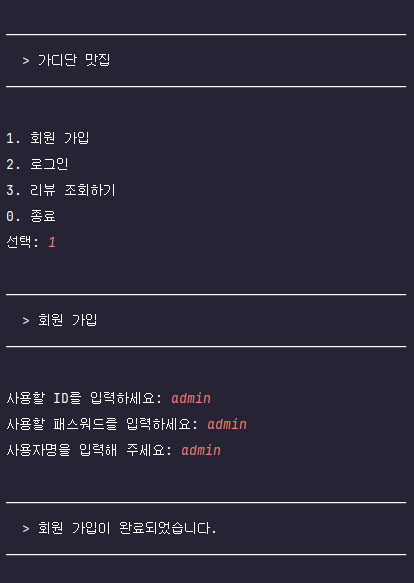
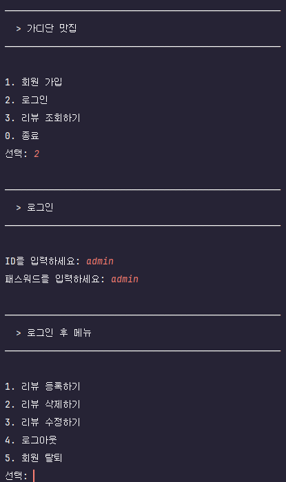

## 📚 가디단 맛집 등록 조회 서비스

### 빌드 및 실행 방법

#### 1. 저장소 복제

```bash
git clone https://github.com/20260921-saltlux-llm-agent-service-2nd/gadidan-matzip.git
cd gadidan-matzip
```

#### 2. 개발 환경 설정

- JDK 21을 설치하고 `JAVA_HOME`을 설정합니다.
- IntelliJ IDEA에서 프로젝트를 열고 Gradle 프로젝트를 동기화합니다.
- 프로젝트 SDK와 Gradle JVM을 JDK 21로 설정합니다.

#### 3. DB 설정 파일 추가

프로젝트 루트를 기준으로 다음 경로에 `db.properties` 파일을 생성합니다.

```text
src/main/resources/db.properties
```

`db.properties`에 입력할 설정 항목과 값은 담당자에게 안내받아 작성합니다.

#### 4. 빌드

프로젝트 루트에서 운영체제에 맞는 명령어를 실행합니다.

Windows (PowerShell):

```powershell
.\gradlew.bat build
```

macOS / Linux:

```bash
chmod +x gradlew
./gradlew build
```

#### 5. 실행

IntelliJ IDEA의 `Settings → Build, Execution, Deployment → Build Tools → Gradle`에서
`Build and run using`을 `IntelliJ IDEA`로 설정합니다.
`com.gadidan.app.run.Application` 클래스의 `main` 메서드를 실행합니다.
실행 구성의 작업 디렉터리(`Working directory`)는 프로젝트 루트로 설정합니다.

---

### 🎯 프로젝트 목표
1. SQL 문법을 익히고, DB 모델링 개념을 학습합니다.
2. MVC 패턴 적용과 사용법을 학습합니다.
3. Git 기반 협업 방식을 학습합니다.

---

#### 1. 아키텍처 구조
```
src/
└── main/
    ├── java/com/gadidan/app/
    │   ├── run/
    │   │   └── Application.java       // 앱 실행 진입점 및 메인 루프
    │   ├── common/
    │   │   ├── Category.java          // 식당 카테고리 enum
    │   │   ├── DatabaseConnectionException.java // DB 연결 실패 예외
    │   │   ├── JDBCTemplate.java      // JDBC 연결 및 자원 해제
    │   │   └── UserSession.java       // 로그인 상태(세션) 관리
    │   ├── model/dto/                 // 데이터 전달 객체
    │   │   ├── UserDto.java
    │   │   ├── RestaurantDto.java
    │   │   └── ReviewDto.java
    │   ├── repository/                // DB 접근 인터페이스
    │   │   ├── UserRepository.java
    │   │   ├── RestaurantRepository.java
    │   │   ├── ReviewRepository.java
    │   │   └── impl/                  // JDBC 기반 구현체
    │   │       ├── UserRepositoryImpl.java
    │   │       ├── RestaurantRepositoryImpl.java
    │   │       └── ReviewRepositoryImpl.java
    │   ├── controller/                // 사용자 요청 처리
    │   │   ├── UserController.java
    │   │   ├── RestaurantController.java
    │   │   └── ReviewController.java
    │   ├── view/
    │   │   └── ConsoleView.java       // 콘솔 입·출력 화면
    │   └── mapper/
    │       └── query.xml              // SQL 쿼리 모음
    └── resources/
        └── db.properties              // DB 연결 설정 (로컬 구성)

```
---
#### 2. Branch Rules
1. `main` 브랜치에 직접 push를 금지한다.
2. 모든 작업 브랜치는 `main` 브랜치로부터 분기하여 작업한다.
3. 브랜치명은 `타입/#이슈번호-작업명` 형태로 생성한다.


#### 3. Git Workflow
`main` 브랜치에서 작업 브랜치 분기 -> 작업 브랜치 커밋 전 `main` 브랜치 `pull`하여 충돌은 로컬에서 해결 -> remote로 `push` 후 `PR` 생성 -> `PR`에 대한 코드 리뷰 후 `main`에 Merge


#### 4. Commit Convention
1. `타입: 작업 내용(한 줄로 작성)` 구조로 작성한다.
2. `타입`과 `작업 내용`은 소문자로 작성한다. (고유 명사의 경우 대문자 허용)
3. 헤더는 영문으로 작성한다. (인코딩 방식에 따른 깨짐 방지 차원. 문법은 틀려도 되지만 의미가 명확히 전달되도록 작성할 것)
4. 바디(본문)를 작성할 경우 헤더로부터 한 줄의 개행을 두고 작성한다.
 

#### 5. Code Convention
학습 목적이기에 코드 컨벤션을 준수하되 코드 리뷰의 평가 요소로 반영하지는 않는다.
1. 모든 클래스명은 대문자로 시작하는 `CamelCase`를 채택한다.
2. 모든 변수명은 소문자로 시작하는 `CamelCase`를 채택하고 명사로 작명한다.
3. 모든 상수는 대문자로 작성하고, 공백은 `_`로 구분한다.
4. 코드는 한 라인 당 최대 `80자`까지 작성하고, 초과할 경우 줄 바꿈으로 작성한다.
5. 매개변수를 받는 메서드의 경우 JavaDoc(`///`)을 활용하여 매개변수 의미를 명시해주는 것을 권장한다.
6. Repository 계층은 인터페이스를 우선 정의하고, 구현체는 {도메인}RepositoryImpl 네이밍을 따른다. 상위 계층(Controller 등)은 구현체가 아닌 인터페이스에만 의존하도록 구성한다. (목적: 테스트 용이성 및 병목 방지)

---

#### 6. 콘솔 사용자 흐름

##### 시작 화면

| 번호 | 메뉴 | 입력 및 이동 흐름 |
| --- | --- | --- |
| 1 | 회원 가입 | ID → 패스워드 → 사용자명 입력 → DB 저장 및 결과 안내 → 첫 화면 |
| 2 | 로그인 | ID → 패스워드 입력 → DB 인증 → 성공 시 로그인 후 메뉴, 실패 시 첫 화면 |
| 3 | 리뷰 조회하기 | 로그인 없이 리뷰 조회 메뉴 이동 |
| 0 | 종료 | 종료 메시지 출력 후 프로그램 종료 |

회원 가입 시 ID는 1~15자이며, 중복 ID는 등록할 수 없습니다.
사용자명은 빈 값으로 입력할 수 있습니다.
로그인에 성공하면 사용자 정보를 `UserSession`에 저장합니다.

##### 리뷰 조회 메뉴

| 번호 | 메뉴 | 입력 및 이동 흐름 |
| --- | --- | --- |
| 1 | 전체 리뷰 조회 | DB에서 전체 리뷰 조회 → 결과 출력 → 리뷰 조회 메뉴 |
| 2 | 리뷰 별점 순 조회 | 별점 내림차순으로 리뷰 조회 → 결과 출력 → 리뷰 조회 메뉴 |
| 3 | 카테고리 별 리뷰 조회 | 카테고리 번호 선택 → 해당 카테고리 리뷰 조회 및 출력 → 리뷰 조회 메뉴 |
| 0 | 뒤로 가기 | 첫 화면으로 이동 |

조회 결과에는 식당명, 별점, 대표메뉴, 카테고리, 한줄평,
등록 날짜와 수정 날짜를 표시합니다. 수정 날짜가 없으면 `-`로 표시합니다.
조회할 리뷰가 없으면 안내 메시지를 출력합니다.

##### 로그인 후 메뉴

| 번호 | 메뉴 | 입력 및 이동 흐름 |
| --- | --- | --- |
| 1 | 리뷰 등록하기 | 식당명 → 카테고리 선택 → 별점 → 대표메뉴 → 한줄평 입력 → DB 저장 및 결과 안내 |
| 2 | 리뷰 삭제하기 | 본인 리뷰 목록 출력 → 삭제할 목록 번호 입력 → DB 삭제 및 결과 안내 |
| 3 | 리뷰 수정하기 | 본인 리뷰 목록 출력 → 수정할 목록 번호 → 새 별점 → 새 한줄평 입력 → DB 수정 및 결과 안내 |
| 4 | 로그아웃 | 세션 정보 제거 → 로그아웃 안내 → 첫 화면 |
| 5 | 회원 탈퇴 | ID → 패스워드 입력 → 로그인 사용자 정보와 일치 여부 확인 → DB에서 회원 삭제 → 로그아웃 후 첫 화면 |

리뷰 등록·삭제·수정을 마치면 로그인 후 메뉴로 돌아갑니다.
회원 탈퇴에 실패하면 로그인 상태를 유지하고 로그인 후 메뉴로 돌아갑니다.

리뷰 등록 시 식당명(`String`), 카테고리 번호(`int`), 별점(`int`),
대표메뉴(`String`), 한줄평(`String`)을 입력받습니다.
입력한 식당명으로 기존 식당을 조회하고, 있으면 해당 식당에 리뷰를 등록합니다.
없으면 식당을 먼저 등록한 뒤 리뷰를 등록합니다.

리뷰 등록과 카테고리별 조회는 `Category` enum 순서에 따라
한식(1), 중식(2), 일식(3), 양식(4), 분식(5), 뷔페(6),
디저트(7) 중 번호를 선택합니다.

리뷰 삭제·수정은 `UserSession`의 사용자 정보를 기준으로 본인이 작성한
리뷰 목록을 조회하고, 1부터 시작하는 목록 번호를 함께 표시합니다.
사용자는 DB의 리뷰 ID 대신 화면에 표시된 목록 번호(`int`)를 입력합니다.
삭제는 선택한 리뷰를 DB에서 삭제하고, 수정은 선택한 리뷰의 별점과
한줄평만 변경합니다.

본인 리뷰가 없거나 입력한 목록 번호가 유효하지 않으면 안내 후
로그인 후 메뉴로 돌아갑니다.

##### 공통 입력 처리

- 메뉴 번호, 별점, 리뷰 목록 번호에 정수가 아닌 값을 입력하면 재입력합니다.
- 메뉴에 없는 정수를 선택하면 안내 후 현재 메뉴를 다시 표시합니다.
- 카테고리 목록에 없는 번호를 선택하면 다시 입력받습니다.
- 리뷰 등록·수정 시 별점 범위를 벗어나면 안내 후 로그인 후 메뉴로 돌아갑니다.
- DB 연결에 실패하면 오류를 안내하고 시작 화면으로 돌아갑니다.
- 콘솔 입력이 끝나면 프로그램을 종료합니다.

### 실행 화면

#### 회원가입


#### 로그인


#### 리뷰 조회


#### 리뷰 등록


#### 리뷰 수정


#### 리뷰 삭제

