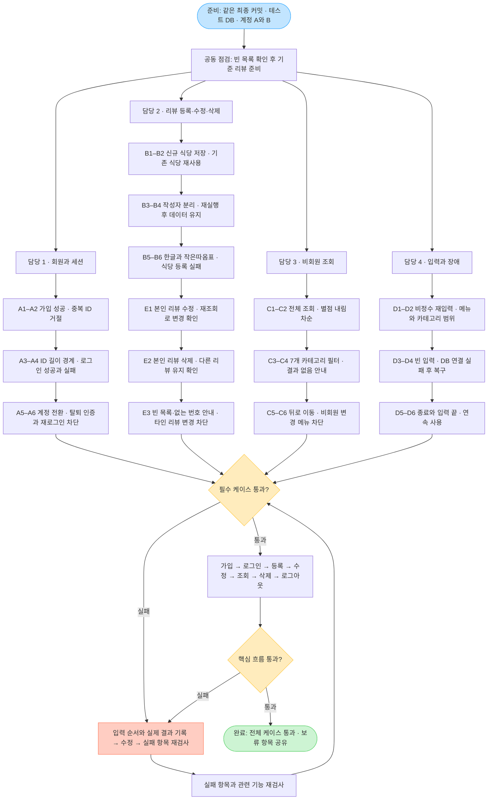

## 결과 기록

| 케이스 ID | 담당자 | 실제 입력·재현 순서 | 기대 결과 | 실제 결과 | 판정 | 수정 후 재검사 |
| --- | --- | --- | --- | --- | --- | --- |
| 예: A2 | 이름 | A 가입 후 같은 ID 재가입 | 중복 거절 | 기록 | 통과/실패/보류/미구현 | 기록 |

실패는 케이스 ID, 입력 순서, 콘솔 메시지, DB 변경 여부를 함께 기록합니다.
비밀번호 등 접속 정보는 캡처에서 가립니다.
필수 케이스가 모두 통과하고 실패 항목의 재검사가 끝나면
가입 → 로그인 → 등록 → 조회 → 로그아웃을 한 번 더 수행합니다.
미구현·보류 항목은 최종 공유 목록에 남깁니다.

## 테스트 흐름

## 진행 방법

- 권장 시간: 60분.
- 모두 같은 최종 커밋과 DB를 사용합니다.
- 담당 1: 회원·세션, 담당 2: 등록·저장, 담당 3: 조회, 담당 4: 입력·장애.
- 본인이 구현하지 않은 기능도 교차 점검합니다.
- DB 장애 점검은 다른 담당자의 점검이 끝난 뒤 별도로 수행합니다.
- 판정은 통과 / 실패 / 보류 / 미구현 중 하나로 기록합니다.
- 화면 메시지뿐 아니라 DB의 행 수와 연결 관계도 확인합니다.
- 필수는 아래 A~D입니다. 정책 미합의 항목은 보류로 남겨 합의하고 재검사합니다.

## A. 회원과 세션

| ID | 실행 방법 | 기대 결과 |
| --- | --- | --- |
| A1 | 서로 다른 ID로 A와 B 가입 후 각각 로그인 | 가입마다 사용자 1행 생성. 입력한 계정으로 로그인 후 사용자 메뉴 진입 |
| A2 | A와 같은 ID로 비밀번호·이름을 바꿔 재가입 | 가입 실패 안내. 기존 계정 정보와 사용자 행 수 유지 |
| A3 | ID를 빈 문자열, 1자, 15자, 16자로 각각 가입 | 빈 문자열·16자는 거절, 중복 없는 1자·15자는 가입 가능. 실패 시 저장 없음 |
| A4 | 올바른 정보, 틀린 비밀번호, 없는 ID, 빈 ID·비밀번호로 로그인 | 정상 정보만 진입. 나머지는 비로그인 상태 유지 |
| A5 | A 로그인 → 로그아웃 → B 로그인 → 리뷰 등록 | 첫 화면으로 복귀 후 B로 로그인. 새 리뷰 작성자가 B이며 A 정보가 섞이지 않음 |
| A6 | 리뷰 있는 A로 로그인 후 틀린 정보로 탈퇴, 이어 올바른 정보로 탈퇴·재로그인 | 틀린 정보는 거절하고 세션 유지. 올바른 정보의 성공 시 사용자 삭제·로그아웃·재로그인 실패. 리뷰 처리 기준은 아래 정책 확인 |

추가 관찰: 이름을 넣어 가입한 직후 다른 사용자를 이름 없이 가입해,
앞 사용자의 이름이 새 계정에 재사용되지 않는지 확인합니다.
이름 생략 자체의 저장값은 팀이 정한 기준과 비교합니다.

## B. 리뷰 등록과 저장

| ID | 실행 방법 | 기대 결과 |
| --- | --- | --- |
| B1 | A로 새로운 QA_한식집 리뷰 등록 후 비회원 전체 조회 | 식당·리뷰가 각각 1행 증가. 입력값·등록일 표시, 작성자·식당 외래키 일치 |
| B2 | B로 같은 QA_한식집에 별점 1 리뷰 등록 | 식당 행 수 유지, 리뷰만 1행 증가. 두 리뷰가 같은 식당 ID를 참조 |
| B3 | A와 B가 서로 다른 내용으로 리뷰 등록 후 DB 확인 | 각 리뷰의 사용자 ID가 실제 로그인 계정과 일치 |
| B4 | 정상 등록 후 프로그램 종료·재실행하여 로그인·조회 | 계정과 리뷰가 유지되고 동일한 내용 조회 |
| B5 | 식당명·대표메뉴·한줄평에 한글, 공백, 작은따옴표 입력 | 예: QA_O'Brien, 오늘의 메뉴, 맛있어요 '추천'. 정상 저장·조회되고 SQL 오류 없음 |
| B6 | 테스트 DB 제약을 확인한 뒤 식당 저장이 거절되는 입력으로 등록 | 식당 실패를 성공으로 안내하지 않고 리뷰도 저장하지 않음. 프로그램 사용 가능 |

B2에서는 카테고리·대표메뉴를 기존 식당과 같게 입력합니다.
같은 식당명에 다른 카테고리·대표메뉴를 입력했을 때의 처리 기준은 별도로 합의합니다.
B6은 스키마에서 거절 조건을 확인할 수 있을 때 수행하며,
조건을 만들 수 없으면 보류 사유를 기록합니다.

## C. 비회원 리뷰 조회

| ID | 실행 방법 | 기대 결과 |
| --- | --- | --- |
| C1 | 비로그인 상태에서 전체 리뷰 조회 | 기준 리뷰 모두 표시. 식당명·별점·대표메뉴·카테고리·한줄평·등록일이 DB와 일치. 등록일 내림차순 |
| C2 | 별점 순 조회로 5·3·1점 리뷰 비교 | 5 → 3 → 1 순서. 같은 별점은 등록일 내림차순. 같은 날짜·점수끼리의 추가 순서는 요구하지 않음 |
| C3 | 카테고리 1~7을 각각 선택 | 선택한 카테고리 리뷰만 표시. 한식은 기준 리뷰 2개, 중식은 1개 확인 |
| C4 | 리뷰 없는 DB에서 전체·별점순 조회, 데이터 없는 카테고리 조회 | 결과 없음 안내 후 계속 사용 가능. 오류 종료 없음 |
| C5 | 조회 메뉴 → 0 → 첫 화면 → 조회 메뉴 재진입 | 정확한 메뉴로 이동하고 입력이 건너뛰어지지 않음 |
| C6 | 비로그인 상태로 첫 화면과 조회 메뉴 확인 | 리뷰 등록·수정·삭제·탈퇴 메뉴가 노출되지 않음 |

## D. 입력과 장애

| ID | 실행 방법 | 기대 결과 |
| --- | --- | --- |
| D1 | 메뉴·별점·목록 번호에 abc, 1.5, 빈 줄, 2147483648 입력 후 정상 정수 입력 | 정수 안내 후 같은 항목 재입력. 이후 입력 순서가 꼬이지 않음 |
| D2 | 첫 화면 9·-1, 조회 메뉴 9, 사용자 메뉴 0·9, 카테고리 0·8 입력 | 없는 메뉴 안내 후 현재 메뉴 유지. 카테고리는 재입력. 카테고리 1·7은 정상 선택 |
| D3 | 가입 비밀번호·이름, 리뷰 식당명·대표메뉴·한줄평에 빈 줄과 공백만 입력 | 필수·선택 기준에 맞게 처리하고 오류 종료 없음. 기준이 없으면 관찰 결과를 기록하고 보류 |
| D4 | 테스트 DB 연결을 일시적으로 끊고 조회 시도 → 복구 → 재조회 | 연결 실패 안내 후 첫 화면 복귀. 복구 후 재시도 성공. 로그인 중 실패했다면 메뉴와 세션 상태도 확인 |
| D5 | 첫 화면 0으로 종료, 별도 실행에서 입력 스트림 종료 | 종료 메시지 후 정상 종료. 입력 종료는 IDE의 stdin 종료 기능 또는 종료 가능한 콘솔에서 확인 |
| D6 | 가입·로그인·등록·로그아웃·조회를 약 10회 반복 | 결과 누락·중복, 계정 정보 혼합, 연결 오류, 비정상 종료 없음 |

## E. 리뷰 수정·삭제 구현 후 추가 점검

| ID | 실행 방법 | 기대 결과 |
| --- | --- | --- |
| E1 | A가 본인 리뷰 수정 후 재조회 | 선택한 리뷰만 변경되고 작성자 유지. 다른 리뷰·식당 정보의 의도치 않은 변경 없음 |
| E2 | A가 본인 리뷰 삭제 후 재조회 | 선택한 리뷰만 제거되고 다른 리뷰 유지. 식당 정리 여부는 합의한 기준과 비교 |
| E3 | 본인 리뷰 없는 계정, 없는 목록 번호, 다른 사용자의 리뷰 선택 시도 | 데이터 변경 없음. 번호 오류·목록 없음 안내, 타인 리뷰 변경 불가 |

실제 목록에 타인 리뷰가 노출되지 않는지도 구현 후 확인합니다.
